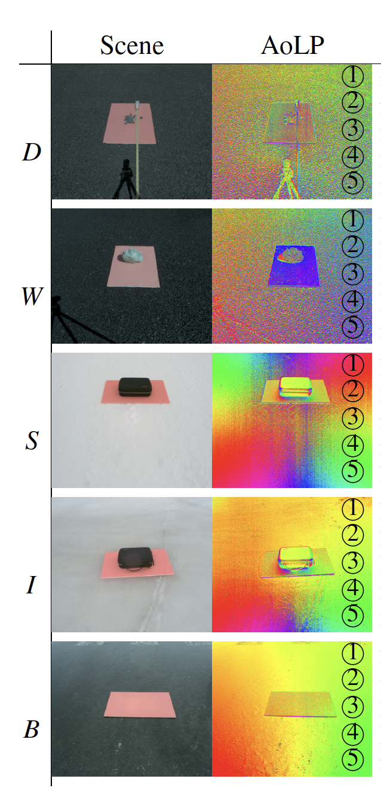

# Road Surface Polarization Dataset

A polarization road-surface dataset including dry, wet, snow, ice, and black-ice conditions.

## Overview

This dataset was collected for research on road-surface condition recognition using polarization information.

The dataset includes polarization and intensity images captured under various road-surface conditions, including dry, wet, snow, ice, and black ice.

## Sample Images

Representative samples of the dataset are shown below.

  

## Dataset Contents

The dataset includes:

- Dry road surfaces
- Wet road surfaces
- Snow-covered road surfaces
- Ice-covered road surfaces
- Black-ice conditions
- Polarization information such as AoLP and DoLP
- Intensity images

Detailed dataset structure and acquisition conditions will be described here.

## Dataset Access

This dataset is available for non-commercial research purposes.

To request access, please complete the following application form:

**Dataset Access Request Form:**  
(To be added)

After reviewing your request, download information will be provided to approved users.

## License

This dataset is provided under the Creative Commons Attribution-NonCommercial 4.0 International License (CC BY-NC 4.0).

Additional access conditions may apply.

## Citation

Citation information will be added after publication.

## Contact

For questions regarding this dataset, please contact:

(To be added)
